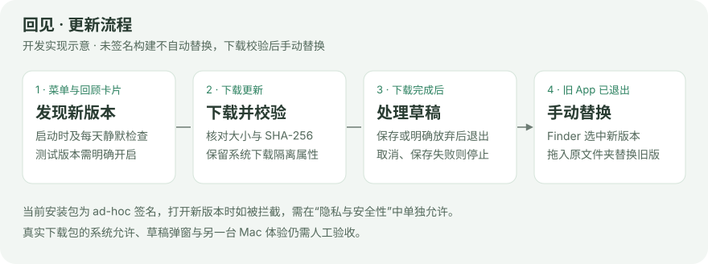

# App 内更新

0.2.18 起支持 App 内更新。0.2.17 及更早版本尚不包含此功能，首次升级到 0.2.18 仍需下载 Release ZIP，保存草稿、正常退出并替换 App。

启动时静默检查一次，不打开设置、不自动下载或安装。菜单栏的更新项与「设置」相邻；发现版本后显示「更新并重启」，回顾卡片左侧也显示可点击的更新提示。点击后自动下载、校验，再进入草稿确认并重启安装。下载中可取消；草稿确认取消或保存失败后保留下载，再次点击「重启更新」即可继续。

「设置 → 关于」仅显示版本、主要操作和简短状态；发布页面的更新内容在发现版本时可打开。正常流程不显示安装包位置、构建来源、架构或校验步骤。下载或安装准备失败时显示简短原因，技术信息与下载目录收在「查看详情」中。没有添加定时轮询、自动下载、镜像或更多更新偏好。

## 版本与通道

- 默认只检查正式版。「测试版本 → 接收预发布版本」需显式开启，按偏好保存；版本信息仍如实标明预发布。已安装过测试版不代表自动同意继续接收预发布。
- 使用 GitHub Releases 的分页列表，按语义版本选择当前通道最高版本，不使用只返回正式版的 `latest` 接口。草稿 Release 被排除；即使 GitHub 未标记，带语义预发布后缀的标签也不进入正式通道。
- 正常发行构建只提示更高版本；开发或来源未标记的构建可下载同版本号的已发布附件。不会自动降级，也不以最新源码构建代替发行包。
- `RemeetBuildKind` 区分开发构建和发行构建。`build-app.sh release` 是优化配置，仍标记为开发构建；`package-release.sh` 只在归档副本中标记发行构建、写入 Release 标签并重新进行 ad-hoc 签名，不修改原 App。标记不证明包已在 GitHub 发布。
- 0.2.18 采用普通 Release，默认更新通道可以发现；0.2.14 至 0.2.17 保留原有预发布标记。当前提供 arm64 包，尚无 Intel 附件；发布状态以 [GitHub Releases](https://github.com/catwithtudou/remeet/releases) 为准。

## 下载与校验

只接受 `catwithtudou/remeet` 对应 Release 下的 `Remeet-<版本>-<架构>.zip` 和同名 `.sha256` 附件；支持脚本生成的 arm64、x86_64 和双架构命名，优先当前硬件架构。Source code ZIP/TAR 不作为安装包。

下载后核对附件大小、SHA-256 文本中的文件名与摘要，以及 GitHub 提供的安装包摘要（如有）。解压前检查归档路径并拒绝符号链接；解压后核对 Bundle ID、版本、最低系统要求、实际 Mach-O 架构和 `codesign --verify --strict`。签名完整性不等于 Developer ID 签名或 Apple 公证。

下载、校验失败或取消时清理本次未完成下载，不替换 App。GitHub 限流、HTTP 错误和解码失败明确报错，不能据此显示“已是最新”。缺少架构包或校验附件时不回退到另一架构、旧附件或源码构建。

完成下载的 ZIP、解压 App 和安装记录位于用户缓存目录的 `local.NotchRecall/Updates/<UUID>/`；仅安装准备失败时提供「查看详情 → 打开下载目录」。不可写目录、App Translocation 和磁盘映像内不自动替换，保留下载供正常退出后手动安装。安装不请求管理员权限。

## 安装、重启与恢复

「更新并重启」在下载校验完成后准备独立安装目录，再通过现有 AppKit 退出入口处理草稿。当前输入先提交到编辑会话，保存、取消、放弃均沿用 `ContentEditorSession.prepareToClose`；保存失败、外部修改冲突或取消会阻止退出和安装。取消后保留已下载安装包，移除本次尚未使用的安装目录。

草稿处理成功后，从当前 App 复制的安装进程先验证安装计划并报告就绪；未就绪则当前 App 不退出。就绪后等待旧进程真正退出，最多等待 60 秒，不强制终止旧 App。退出后再次核对新旧包的签名和文件指纹，防止安装准备后被其他操作替换。

旧包先完整备份到安装路径旁的 `.remeet-update-<UUID>/previous.app`。同一卷上的 `RENAME_SWAP` 原子交换候选与安装路径；中断不会造成安装路径暂时没有 App。新版本通过 `NSWorkspace`／Launch Services 正常启动，核对启动路径、完成启动状态及前三秒进程存活。

替换或启动失败时原子交换回旧包，再正常启动原版本。回退或原版本启动也失败时保留新旧包和 `installation.json`，明确报告需要手动处理。新进程尚未退出时不强行终止、不替换运行中的程序，保留备份供退出后恢复。安装成功也保留旧包和记录，不自动删除恢复材料；可从记录中的 `workspace` 找到备份。三秒启动检查不保证长期稳定，也不证明完整业务验收。

如果系统把新版本放到 App Translocation 隔离路径启动，安装会因路径不匹配而停止。安装进程先请求本次启动的新 App 正常退出，确认退出后再回退；若拒绝退出，则保留新旧包供手动恢复，不强制终止，也不退出此前已经运行的其他 App。

内容目录、笔记、导入／编辑备份、草稿导出及偏好域不参与 App 交换，不执行迁移或重置。安装前同步现有偏好。

## 系统允许与验收边界

下载的 ZIP 和解压 App 均设置并保留 `com.apple.quarantine`，复制、交换不移除它；新版本只通过系统启动，不直接运行下载的可执行文件，不关闭 Gatekeeper。当前 ad-hoc 包若被系统拦截，安装会失败并恢复旧 App。用户可按 [Apple 官方流程](https://support.apple.com/zh-cn/102445) 查看原因并单独允许，之后从下载目录手动安装；文件损坏、恶意软件或管理策略拦截不能当作普通未公证提示。

自动化分开验证：语义版本／通道／分页与错误处理；实际 Release 附件下载及校验；本地无隔离属性的 Debug 夹具通过独立 helper 和 Launch Services 替换、启动、失败回退及数据保持。夹具不是发布包，不能替代真实下载包的 Gatekeeper 允许、实际草稿弹窗、只读安装位置、另一台 Mac 或 macOS 14／15 的实机验收。
